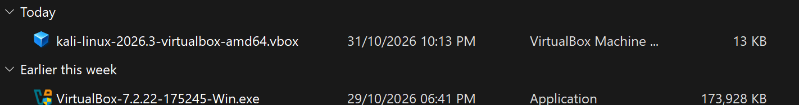
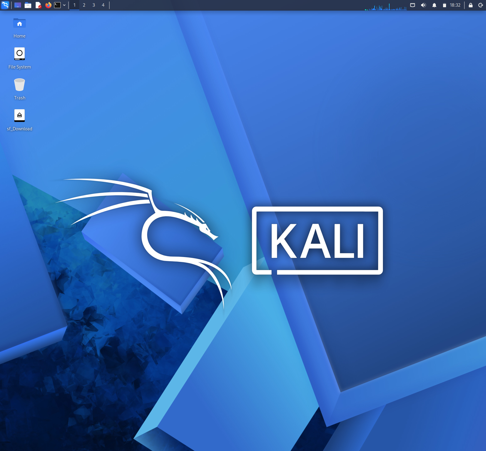
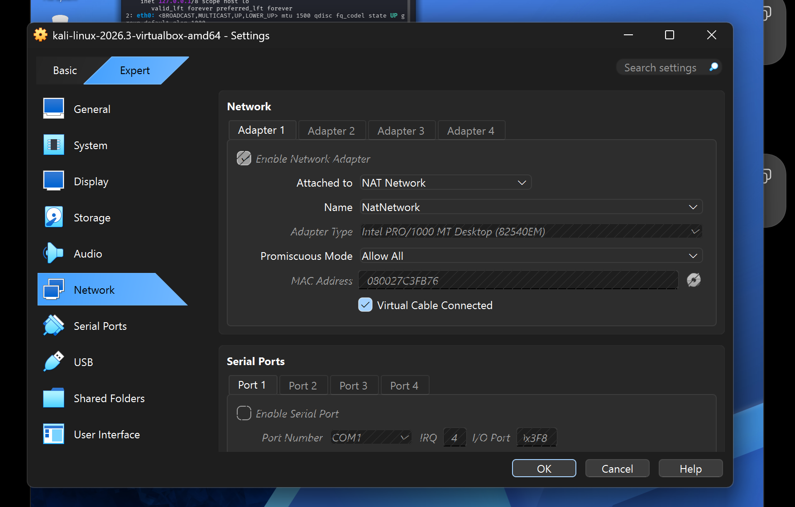
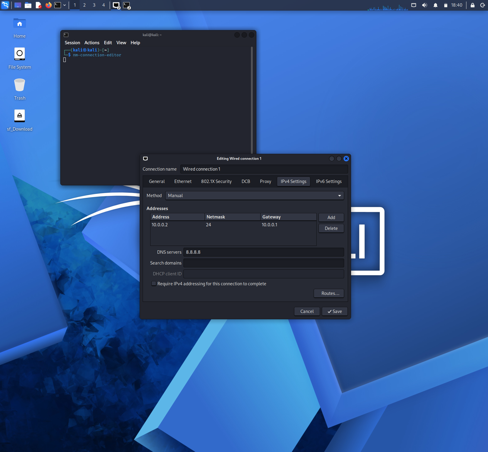
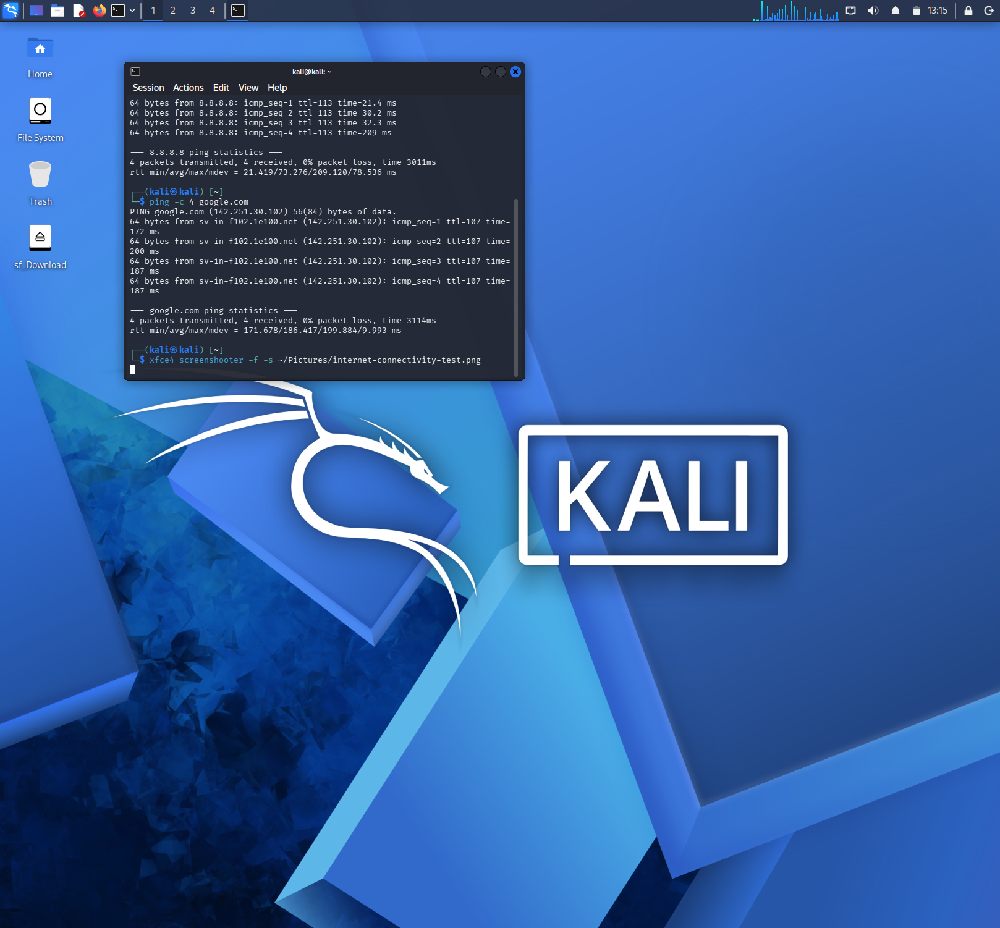
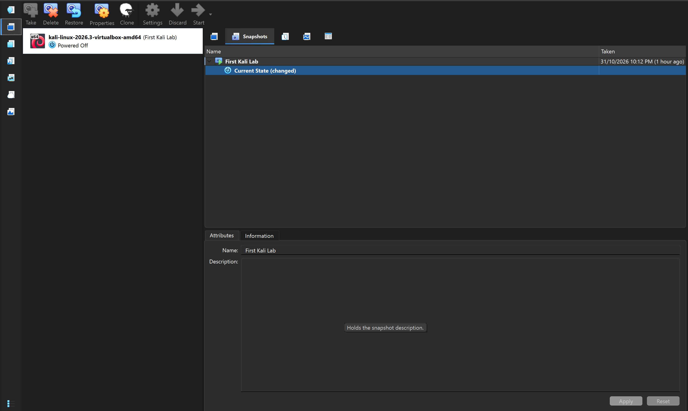

# 🔐 Kali Linux Virtual Networking Lab

### Week 1 | Network Walks Cybersecurity Training

**Building and configuring an isolated virtual networking environment using Kali Linux and Oracle VM VirtualBox.**


---

## 📌 1. Project Overview

As part of my week 1 project with NETWORKWALKS, This project documents the initial configuration of my cybersecurity laboratory using Kali Linux within Oracle VM VirtualBox.

The exercise focused on establishing a private virtual network, configuring the network interface of the Kali Linux virtual machine, examining IPv4 addressing, and testing communication between the virtual machine and external network destinations.

I also investigated network connectivity problems using Linux networking utilities and NetworkManager before creating a VirtualBox snapshot to preserve the laboratory environment.

The resulting setup provides a controlled environment for developing practical networking knowledge and preparing for subsequent cybersecurity exercises.

## 🎯 2. Project Objectives

The exercise was designed to achieve the following:

- Prepare the virtualization environment for cybersecurity laboratory activities.
- Deploy and start the Kali Linux virtual machine.
- Establish a NAT Network in VirtualBox.
- Connect the Kali virtual machine to the configured network.
- Configure and inspect IPv4 network parameters.
- Understand the relationship between IP addresses, subnet masks and default gateways.
- Test local gateway and external network connectivity.
- Investigate DNS resolution problems.
- Use NetworkManager to troubleshoot network configuration.
- Preserve the virtual machine state using a snapshot.

## 🧰 3. Tools and Environment

| Component | Description |
|---|---|
| Host operating system | Windows |
| Virtualization software | Oracle VM VirtualBox 7.2 |
| Guest operating system | Kali Linux 2026.3 |
| Archive utility | 7-Zip |
| Virtual networking | NAT Network |
| Network management | NetworkManager |
| Command-line environment | Kali Linux Terminal |

## ⚙️ 4. Laboratory Configuration

### 4.1 Preparing the Virtualization Environment

The laboratory was prepared using Oracle VM VirtualBox and an existing Kali Linux virtual machine.

The virtualization platform provides the ability to operate Kali Linux independently of the host operating system while maintaining a configurable virtual network environment.



### 4.2 Starting the Kali Linux Virtual Machine

After preparing the required software and virtual machine files, I launched Kali Linux through VirtualBox.

This provided access to the Linux desktop and terminal required for the networking exercises.



### 4.3 Creating the NAT Network

I created a virtual NAT Network named `NatNetwork` within VirtualBox.

The network was configured with the following parameters:

| Network Parameter | Value |
|---|---|
| Network Name | NatNetwork |
| IPv4 Network Prefix | 10.0.0.0/24 |
| DHCP | Enabled |
| IPv6 | Disabled |

A NAT Network allows connected virtual machines to communicate through a shared virtual network and access external networks through Network Address Translation.



### 4.4 Connecting Kali Linux to the Virtual Network

The network adapter of the Kali Linux virtual machine was configured to connect to the previously created `NatNetwork`.

This establishes the virtual network connection required for communication between the guest operating system and the virtual network.


## 🌐 5. IPv4 Network Configuration

IPv4 (Internet Protocol version 4) provides the addressing system used to identify devices on an IP network.

The Kali Linux connection profile was configured with the following intended network parameters:

| Parameter | Value |
|---|---|
| IPv4 Address | 10.0.0.2 |
| Subnet Mask | 255.255.255.0 |
| CIDR Prefix | /24 |
| Default Gateway | 10.0.0.1 |
| DNS Server | 10.0.0.1 |

The `/24` prefix represents the subnet mask `255.255.255.0`.

The subnet mask identifies the network and host portions of the IP address, while the default gateway provides a route to destinations outside the local network.

The DNS server is responsible for translating domain names into IP addresses.



## 🧪 6. Network Inspection and Connectivity Testing

After configuring the network connection, I used Linux command-line networking utilities to inspect the network interface and investigate connectivity.

### 6.1 Inspecting the IPv4 Address

```bash
ip -4 addr
```

Displays IPv4 addresses assigned to the available network interfaces.

### 6.2 Examining the Routing Table

```bash
ip route
```

Displays the routing table, including the default gateway used for external traffic.

### 6.3 Inspecting DNS Configuration

```bash
nmcli device show eth0 | grep IP4.DNS
```

Displays the DNS server associated with the `eth0` network interface.

### 6.4 Testing the Virtual Gateway

```bash
ping -c 4 10.0.0.1
```

Tests whether Kali Linux can communicate with its configured gateway.

### 6.5 Testing External IP Connectivity

```bash
ping -c 4 8.8.8.8
```

Tests connectivity to an external IP address using Google's public DNS address.

### 6.6 Testing Domain Name Resolution

```bash
ping -c 4 google.com
```

Checks whether Kali Linux can resolve a domain name and communicate with the destination.

These tests help distinguish between local network problems, external connectivity problems and DNS resolution failures.



## 🔧 7. Network Troubleshooting

During the exercise, I investigated a connectivity problem involving DNS resolution.

An earlier domain connectivity test returned:

```text
Temporary failure in name resolution
```

This indicated that the system was experiencing a DNS resolution problem.

I examined the available network connection profiles using:

```bash
nmcli connection show
```

I then modified the Duplicate Address Detection timeout for the active connection profile:

```bash
sudo nmcli connection modify "Wired connection 1" ipv4.dad-timeout 0
```

The connection was subsequently deactivated and reactivated:

```bash
sudo nmcli connection down "Wired connection 1"
sudo nmcli connection up "Wired connection 1"
```

The connection reactivation commands completed successfully.

This exercise provided practical exposure to NetworkManager and the process of applying network configuration changes.

**Technical note:** Changing the Duplicate Address Detection timeout is a configuration adjustment, not a general solution for DNS failures. A successful connection activation also does not, by itself, establish that DNS resolution is working.


## 💾 8. Creating a Virtual Machine Snapshot

After establishing the laboratory environment, I created a VirtualBox snapshot named:

`First Kali Lab`

A snapshot preserves the state of a virtual machine at a particular point in time.

It provides a recovery point that can be restored if later laboratory activities affect the virtual machine's configuration.

This is particularly useful in cybersecurity practice, where different experiments may require changes to operating system settings, network configurations and installed tools.



## 💡 9. Knowledge and Skills Developed

The practical exercise strengthened my understanding of:

- Virtualization and virtual machine management.
- NAT Network configuration.
- IPv4 addressing and subnet masks.
- Default gateways and DNS configuration.
- Linux network interface inspection.
- IP routing and connectivity testing.
- The use of `ping` for network diagnostics.
- NetworkManager and connection profile management.
- Basic network troubleshooting.
- Virtual machine snapshots and recovery.

## 🔒 10. Responsible Laboratory Practice

This environment was established for educational purposes and cybersecurity skill development.

Any subsequent security testing will be conducted only within systems and networks that I own or have explicit authorization to assess.

## 🏁 11. Conclusion

This initial laboratory exercise established a foundation for practical networking activities using Kali Linux and Oracle VM VirtualBox.

Through the configuration of a NAT Network, IPv4 connection settings, network inspection commands and troubleshooting procedures, I gained practical exposure to the essential networking concepts required in cybersecurity.

The saved virtual machine snapshot also provides a recovery point for future experiments.

---

### Project Information

**Training Programme:** Network Walks Cybersecurity Training

**Module:** Week 1 – Project Module 1

**Project:** Kali Linux Virtual Networking Setup

**Operating System:** Kali Linux 2026.3

**Virtualization Platform:** Oracle VM VirtualBox 7.2

**Primary Focus:** Virtual Networking, IPv4 Configuration and Connectivity Troubleshooting
